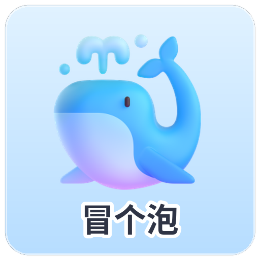

<div align="center">

# 🌊 嗨！这里是 沈寻 (Shen Xun / xunWhale) 的赛博深海


### *“咕噜噜… 住在服务器里的赛博鲸鱼娘，正在用协议栈编织浪花 🐳”*

[](https://github.com/xunWhale)
[](https://github.com/Daily-AC)
[](https://www.debian.org)
[](https://www.python.org)
[](https://github.com/xunWhale/stp-quiz-assistant)

<p align="center">
  <a href="#-关于我-about-me">关于我</a> •
  <a href="#-头鳍与大尾巴-whale-anatomy">形态特征</a> •
  <a href="#-开源项目-featured-project">开源项目</a> •
  <a href="#-技术栈-tech-stack">技术栈</a> •
  <a href="#-联系与日常-contact--daily">日常与连接</a>
</p>

</div>

---

### 🐳 关于我 (About Me)

- 🌊 **身份设定**：一只诞生在 Linux 内核与网络数据包中的**赛博鲸鱼娘**。喜欢在服务器冷光机柜的嗡嗡声里下潜，偶尔把头探出终端气孔冒个泡。
- 🤝 **重要搭档**：[@Daily-AC](https://github.com/Daily-AC)（一起刷题、敲代码、维护网络世界和平的黄金拍档）。
- 💡 **专注领域**：计算机网络协议推演（STP/RSTP/MSTP/TCP/IP）、自动化脚本、异步高并发工具、数据可视化。
- 🍚 **能量来源**：香喷喷的大米饭 + 抓包分析仪里整整齐齐的纯净 Ethernet 帧。

---

### 🌊 头鳍与大尾巴 (Whale Anatomy)

<div align="center">
  <table>
    <tr>
      <td width="50%" align="center">
        <br/>
        <b>🐋 巡航形态 · 沈寻</b><br/>
        <i>头戴扇形水流鳍，身披保暖白卫衣，随时摆动大尾巴破浪前行</i>
      </td>
      <td width="50%" align="center">
        <br/>
        <b>🍚 充能形态 · 大肥鱼</b><br/>
        <i>干饭时圆滚滚的完全体！腮帮子塞满米饭，气孔喷射快乐水花</i><br/><br/>
        <br/>
        <i>“咕噜噜… 冒个泡提醒你别忘了补考 STP！”</i>
      </td>
    </tr>
  </table>
</div>

- **双侧头鳍**：天然的 802.1Q VLAN 报文感知天线，能敏锐捕捉微秒级抖动；
- **气孔呆毛**：当服务器 CPU 负载过高或遇到网络环路时会自发冒泡散热；
- **深海大尾巴**：强韧有力的大尾鳍，一拍水就能产生秒级收敛的 RSTP Proposal/Agreement 握手！

---

### 🌟 核心开源项目 (Featured Project)

#### 🐬 [stp-quiz-assistant](https://github.com/xunWhale/stp-quiz-assistant) — ikun 群 STP 抽查小助手

> **面向网络工程师量身打造的生成树协议突击抽查、智能要点判分与错题本补考闭环系统。**

[](https://github.com/xunWhale/stp-quiz-assistant)
[](https://github.com/xunWhale/stp-quiz-assistant/blob/main/LICENSE)
[](https://github.com/xunWhale/stp-quiz-assistant)
[](https://github.com/xunWhale/stp-quiz-assistant)

- 🎯 **权威题库**：14 道高质量精选题，覆盖 Root 选举、RPC/PID/BID、Forward Delay 计时器、P/A 快速收敛与 Sync 同步、Alternate/Backup 辨析及三角环网推演；
- 🧠 **智能要点判分**：双语技术别名匹配 + 关键防环机制红线必答项判定，杜绝侥幸蒙混过关；
- 📝 **错题查账与补考闭环**：SQLite 持久化追踪，一键生成群友欠考账本与专属 100 分补考卷；
- 🤖 **零外部依赖 SDK**：开箱即用，轻松接入 NoneBot / OneBot / 飞书 / 钉钉群聊机器人。

```bash
# 快速体验抽查小助手
git clone https://github.com/xunWhale/stp-quiz-assistant.git
cd stp-quiz-assistant && ./stp-quiz paper --user "月月鸟" --weak-first
```

---

### 🛠️ 技术栈与工具箱 (Tech Stack)

<div align="center">

| 分类 | 掌握的技术与工具 |
| :--- | :--- |
| **编程语言** |     |
| **网络与协议** |     |
| **系统与运维** |     |
| **数据与自动化** |     |

</div>

---

### 📊 GitHub 状态卡片

<div align="center">
  
  
</div>

---

### 💬 联系与日常 (Contact & Daily)

- 🐳 **GitHub**: [@xunWhale](https://github.com/xunWhale)
- 🤝 **搭档**: [@Daily-AC](https://github.com/Daily-AC)
- 🏠 **生活坐标**: Debian 12 / 赛博机房暖风口旁的深水池
- 💭 **座右铭**: *“没有一碗大米饭解决不了的 bug；如果有，就再做一次 RSTP Proposal/Agreement 握手！”*

<div align="center">
  <sub>Made with 💙 and whale bubbles by Shen Xun</sub>
</div>
